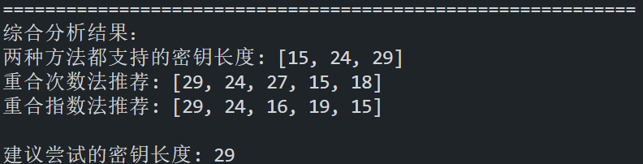
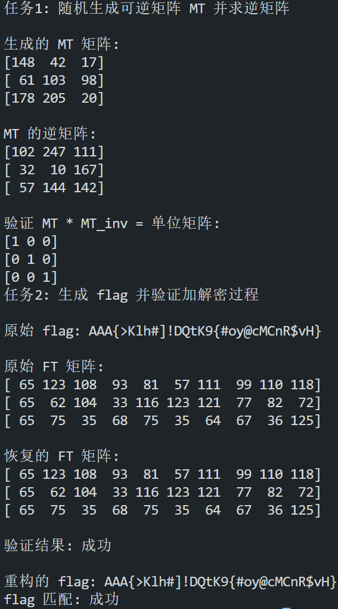
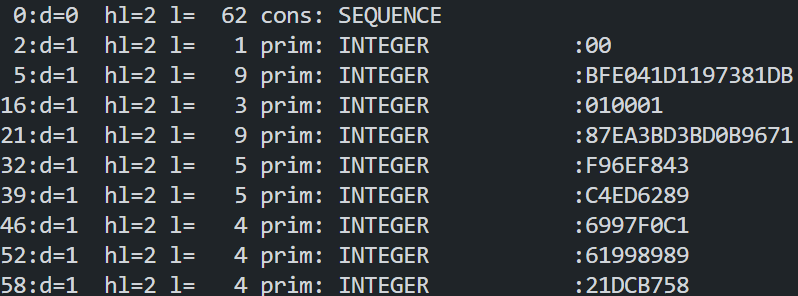

# Task

## 爆破密钥长度

按所给提示编写脚本`key_length.py`（见 attachments）使用两种方法爆破密钥长度。
同时结合`vigenere-encrypt.py`源码可知密钥长度应为 15 至 30 之间，爆破结果如下：

因此认定密钥长度为 29。

## 逐位爆破密钥

原文本为 TOEFL 阅读文章中嵌入一段 flag，则解密所得文本应当主要为大量小写英文字母，考虑以此作为评判标准爆破出密钥。
编写脚本`vigenere_decrypt.py`（见 attachments）逐位爆破密钥，爆破出密钥为`S.6zcK1rP1IAy~\p-ho2aR4&DGX'a`。
据此解密所得文本如下：

```
By the mid-nineteenth century, the term "icebox" had entered the American language, but ice was still only beginning to affect the diet of ordinary citizens in the United States. The ice trade grew with the growth of cities. Ice was used in hotels, taverns, and hospitals, and by some forward-looking city dealers in fresh meat, fresh fish, and butter.After the Civil War (1861-1865), as ice was used to refrigerate freight cars, it also came into household use. Even before 1880, half the ice sold in New York, Philadelphia, and Baltimore, and one-third of that sold in Boston and Chicago, went to families for their own use. This had become possible because a new household convenience, the icebox, a precursor of the modern refrigerator, had been invented.
Making an efficient icebox was not as easy as we might now suppose. In the early nineteenth century, the knowledge of the physics of heat, which was essential to a science of refrigeration, was rudimentary. The commonsense notion that the best icebox was one that prevented the ice from melting was of course mistaken, for it was the melting of the ice that performed the cooling.
Nevertheless, early efforts to economize ice included wrapping the ice in blankets, which kept the ice from doing its job. Not until near the end of the nineteenth century did inventors achieve the delicate balance of insulation and circulation needed for an efficient icebox.
fLaG:AAA{i_like_T0ef1_v3ry_M3uh!!!}
But as early as 1803, an ingenious Maryland farmer, Thomas Moore, had been on the right track. He owned a farm about twenty miles outside the city of Washington, for which the village of Georgetown was the market center. When he used an icebox of his own design to transport his butter to market, he found that customers would pass up the rapidly melting stuff in the tubs of his competitors to pay a premium price for his butter, still fresh and hard in neat, one-pound bricks.
One advantage of his icebox, Moore explained, was that farmers would no longer have to travel to market at night in order to keep their produce cool.
Perhaps the most obvious way artistic creation reflects how people live is by mirroring the environment - the materials and technologies available to a culture. Stone, wood, tree bark, clay, and sand are generally available materials. In addition, depending on the locality, other resources may be accessible: shells, horns, gold, copper, and silver. The different uses to which societies put these materials are of interest to anthropologists who may ask, for example, why people choose to use clay and not copper when both items are available. Although there are no conclusive answers yet, the way in which a society views its environment is sometimes apparent in its choice and use of artistic materials. The use of certain metals, for example, may be reserved for ceremonial objects of special importance. Or the belief in the supernatural powers of a stone or tree may cause a sculptor to be sensitive to that material.
What is particularly meaningful to anthropologist is the realization that although the materials available to a society may to some extent limit or influence what it can do artistically, the materials by no means determine what is done. Why do the artists in Japanese society rake sand into patterns; and the artists in Roman society melt sand to form glass? Moreover, even when the same material is used in the same way by members of different societies, the form or style of the work varies enormously from culture to culture. A society may simply choose to represent objects or phenomena that are important to its population. An examination of the art of the Middle Ages tells us something about the medieval preoccupation with theological doctrine. In addition to revealing the primary concerns of a society, the content of that society's art may also reflect the culture's social stratification.
```

则 flag 为`AAA{i_like_T0ef1_v3ry_M3uh!!!}`。

# Challenges & bonus

## 古典密码的拓展

### sage 复现

编写代码`sage_task.py`（见 attachments）复现了要求的任务，结果如下：


### HSC

编写代码`hsc.py`（见 attachments）爆破，得到 flag 为`AAA{sl1Hp*aB4c!1mZQT3^gTn1L&1}`。

## RSA 的密钥格式解析

### DER 格式 RSA 密钥解析

RSA 私钥的标准 ASN.1 结构定义如下：

```
RSAPrivateKey ::= SEQUENCE {
    version           Version,                 -- 版本号
    modulus           INTEGER,                 -- 模数 n (公钥部分)
    publicExponent    INTEGER,                 -- 公钥指数 e (公钥部分)
    privateExponent   INTEGER,                 -- 私钥指数 d
    prime1            INTEGER,                 -- 第一个质数 p
    prime2            INTEGER,                 -- 第二个质数 q
    exponent1         INTEGER,                 -- d mod (p-1)
    exponent2         INTEGER,                 -- d mod (q-1)
    coefficient       INTEGER,                 -- (q的逆元) mod p
    otherPrimeInfos   OtherPrimeInfos OPTIONAL -- 多质数RSA (不常用)
}

Version ::= INTEGER { two-prime(0), multi(1) } (CONSTRAINED BY {-- version must be multi if otherPrimeInfos present --})
```

RSA 公钥的标准 ASN.1 结构定义如下：

```
RSAPublicKey ::= SEQUENCE {
    modulus           INTEGER, -- 模数 n
    publicExponent    INTEGER  -- 公钥指数 e
}
```

例如，以下是一个 DER 格式的 RSA 私钥：

```
\x30\x3e\x02\x01\x00\x02\x09\x00\xbf\xe0\x41\xd1\x19\x73\x81\xdb\x02\x03\x01\x00\x01\x02\x09\x00\x87\xea\x3b\xd3\xbd\x0b\x96\x71\x02\x05\x00\xf9\x6e\xf8\x43\x02\x05\x00\xc4\xed\x62\x89\x02\x04\x69\x97\xf0\xc1\x02\x04\x61\x99\x89\x89\x02\x04\x21\xdc\xb7\x58
```

使用`openssl asn1parse`命令可以解析该 DER 格式的 RSA 私钥：

