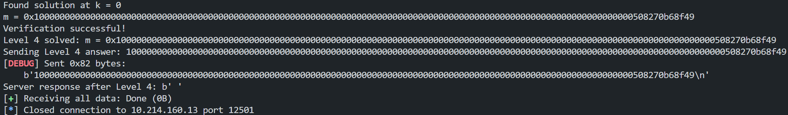

# RSA 部分

## EndlessRSA1

攻击脚本为`endlessRSA1.py`（见 attachments），攻击步骤如下：
先爆破通过 sha256 验证。
level0 为给出全部 n,e,c,p,q 的值，直接计算 d 即可。
level1 为给出 n,e,c 的值，调用 yafu 分解 n 得到 p,q，然后计算 d。
level2 为使用了同一个 n 和两组 e 进行加密，采用共模攻击。
level3 为 e 数量级与 n,c 相当，则 d 较小，采用 Wiener 攻击。
level4 为使用了同一个 e 和三组 n 进行加密，采用广播攻击。
level4 发送正确答案后未收到服务器进一步响应，未能进行后续步骤。


## Crossed Wires

根据所提供的源码`source.py`及`output.txt`，容易逆向编写出`crossed_wires.py`（见 attachments），运行得到 flag 为`crypto{3ncrypt_y0ur_s3cr3t_w1th_y0ur_fr1end5_publ1c_k3y}`

## Everything is Still Big

根据所提供的源码`source.py`及`output.txt`，容易逆向编写出`everything_is_still_big.py`（见 attachments），运行得到 flag 为`crypto{bon3h5_4tt4ck_i5_sr0ng3r_th4n_w13n3r5}`

## Endless Email

根据所提供的源码`johan.py`及`output.txt`，逆向编写出`endless_email.py`（见 attachments），运行得到 flag 为`crypto{1f_y0u_d0nt_p4d_y0u_4r3_Vuln3rabl3}`

# DLP 部分

## EZDLP

直接调用 sage 库中的`discrete_log`函数计算`x`或利用 BSGS 算法计算`x`，编写代码`ezdlp.py`（见 attachments），均出现程序卡死无法得到结果。

# Bonus

## RSA: Franklin-Reiter 相关消息攻击

- 原理：
  当两个明文满足线性关系$m_2=a \cdot m_1+b$且使用相同公钥$(n,e)$加密时，可通过构造多项式求 gcd 恢复明文。
- 条件：

  - 已知$c_1 \equiv m^e_1 \bmod n,c_2 \equiv (a \cdot m_1+b)^e \bmod n$
  - 攻击复杂度为$O(e^2)$，适用于较小的$e$

- Exp:

  ```python
  def franklin_reiter_attack(c1, c2, a, b, e, n):
      PR.<x> = PolynomialRing(Zmod(n))
      f1 = x^e - c1
      f2 = (a*x + b)^e - c2
      return int(-gcd(f1, f2).coefficients()[0])

  # 示例
  n = 0xabcdef... # 模数
  e = 3
  a, b = 2, 3   # m2 = 2*m1 + 3
  c1 = pow(m1, e, n)
  c2 = pow(2*m1 + 3, e, n)

  m1_recovered = franklin_reiter_attack(c1, c2, a, b, e, n)
  ```

## DLP: 指数演算法

- 原理：
  利用光滑数分解，在乘法群$F^*_p$中求解离散对数$g^x \equiv h \bmod p$：
  1. 选择小素数集合$B=\{p_1,p_2, \ldots ,p_k\}$
  2. 找$k$组$g^{a_i} \equiv \prod_j{p^{e_{ij}}_j} \bmod p$
  3. 解方程组$\sum_i{e_{ij} \log_g{p_j}} \equiv a_i \bmod p-1$
  4. 找$h \cdot g^b=\prod{p^{v_j}_j}$，则$x=(\sum_j{v_j \log_g{p_j}-b}) \bmod p-1$
- Exp:

  ```python
  p = 1000003  # 素数模数
  g = Mod(2, p)  # 生成元
  h = g ^ 12345  # 目标值 (x=12345)
  # 因子基 (小于平滑界)
  B = [primes[i] for i in range(100)]
  # 步骤1：预计算离散对数表
  log_table = {}
  M = []
  for p_j in B:
      while True:
          k = randint(1, p - 1)
          gk = g ^ k
          if gk.is_smooth(B):  # 判断是否B-光滑
              fac = gk.factor()
              exp_vec = [fac[p_j] if p_j in fac else 0 for p_j in B]
              M.append(exp_vec)
              log_table[p_j] = k  # log_g(p_j) ≡ k
              break
  # 步骤2：求解目标离散对数
  b = randint(1, p - 1)
  hb = h * g ^ b
  if hb.is_smooth(B):
      v = [hb.factor().get(p_j, 0) for p_j in B]
      x = sum(v[j] * log_table[p_j] for j in range(len(B))) - b
      x %= p - 1
      print(f"Found x = {x}")
  ```
