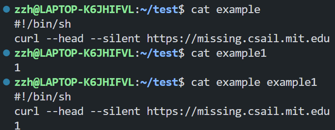
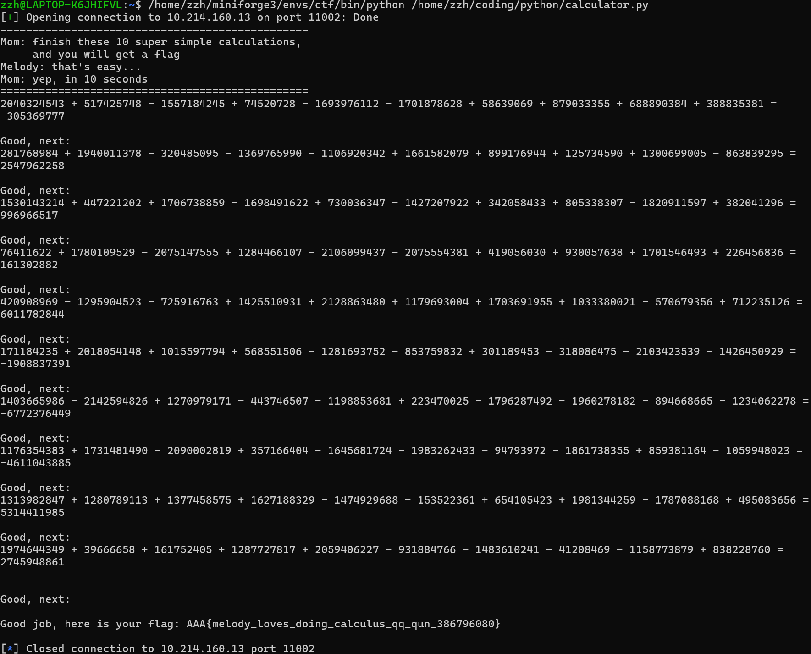
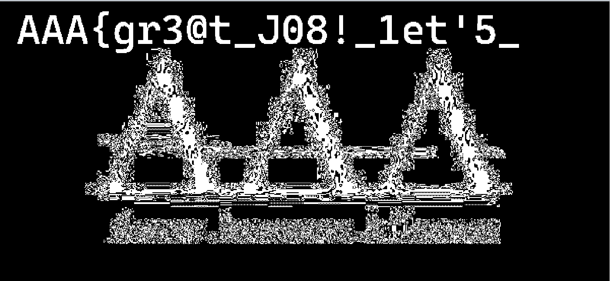

# Lab 0

## Prerequisite

### Challenge 1

#### shell 命令的用法介绍与实操

- `touch`
  - 用法：修改文件时间戳，若目标文件不存在且未提供`-c`或`-h`则创建一个空文件。
  - 实操：
- `cat`
  - 用法：连接文件并打印到标准输出。
  - 实操：
- `chmod`
  - 用法：更改文件或目录的权限。
  - 实操：
- `grep`
  - 用法：搜索并打印文本文件中符合条件的行。
  - 实操：

#### Saint John

搜索可知`fuser`命令可以用来查找正在使用某个文件的进程，`kill`掉对应进程即可。


### Challenge 2

#### python 程序执行与功能解释


功能：接受任意字符串，输出字符串长度并将字符串中小写英语字母转换为大写。

#### calculator

```python
from pwn import *
import re

def solve_challenge(host='10.214.160.13', port=11002):
    # 使用pwntools创建连接
    conn = remote(host, port)

    # 连续解决10个挑战
    for i in range(10):
        expr_line = None
        while not expr_line:
            # 接收数据直到新行
            data = conn.recv().decode()
            print(data.strip())
            # 使用相同的正则表达式提取数学表达式
            match = re.search(r'([0-9+\-\s]+)=', data)
            if match:
                expr_line = match.group(1).strip()

        # 计算答案
        answer = str(eval(expr_line)) + '\n'
        print(answer)

        # 发送答案
        conn.send(answer.encode())

    # 接收最终结果
    result = conn.recv()
    print(result.decode())

    # 关闭连接
    conn.close()

if __name__ == '__main__':
    solve_challenge()
```



flag: `AAA{melody_loves_doing_calculus_qq_qun_386796080}`

## Misc

### Challenge 1

将所给字符串

```
;cR!f<`MjL9eg<R<bl5:;D9go<,6#?<CUXo<)lXK;cPZ";D9h.=);&:<bu;I9l*Er<A8VO<GYQ"<blqZ<%p0t<bbf5<GY,q;cH@l9kl@B:f0A=
```

输入 cyberchef,经由自动识别依次进行`From Base85`、`From Base64`、`From Base32`解码，得到 flag: `AAA{wELc0m3_t0_Ctf_5umMEr_c0UrsE_2025}`

### Challenge 2

flag 第一部分：利用 StegSovlve 查看 R/G/B 通道的最低位平面均可发现文字，为`AAA{gr3@t_J08!_1et'5_`

flag 第二部分：利用`strings`命令，观察到文件尾异常字节，为`P1@y_m1SC_TOG3Th3R}`
拼接为 flag: `AAA{gr3@t_J08!_1et'5_P1@y_m1SC_TOG3Th3R}`