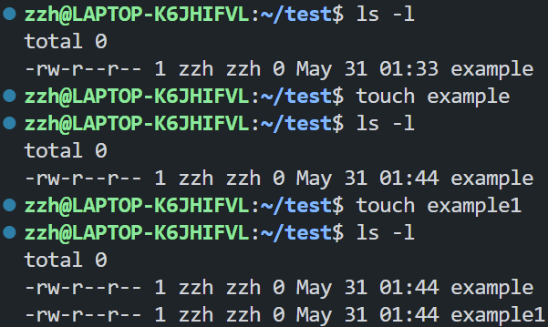
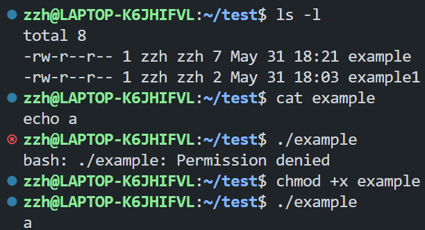
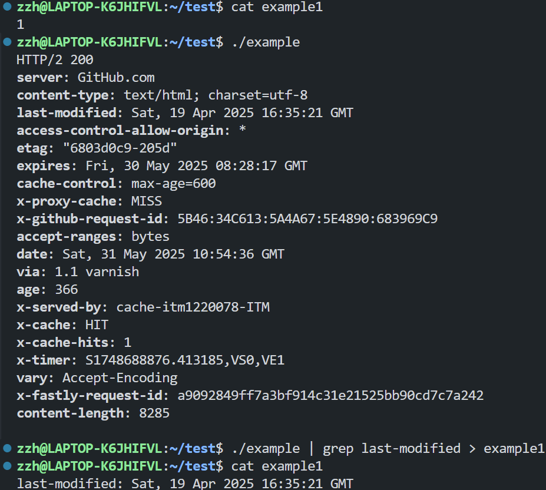
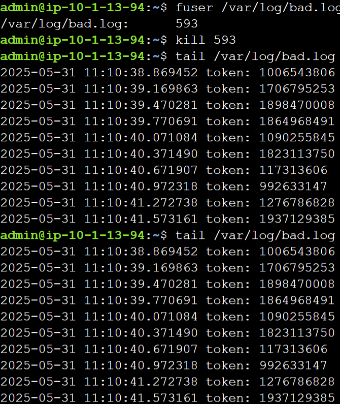
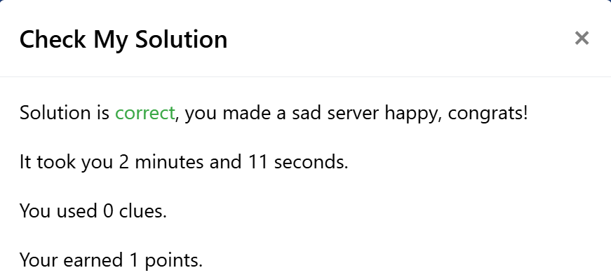
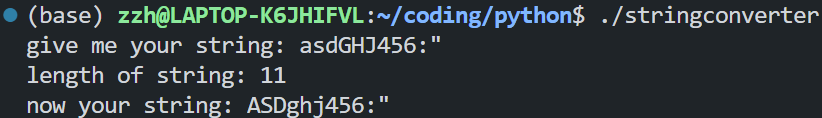
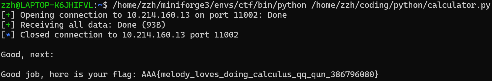
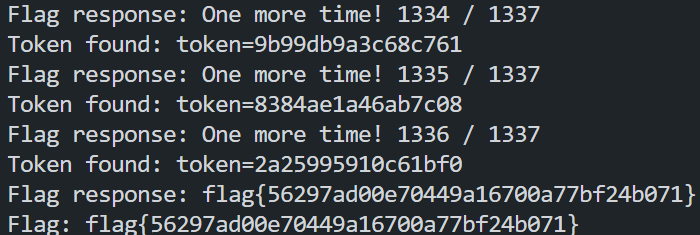
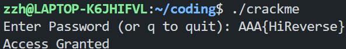

# Lab 0

## Prerequisite

### Challenge 1

#### shell 命令的用法介绍与实操

- `touch`
  - 用法：修改文件时间戳，若目标文件不存在且未提供`-c`或`-h`则创建一个空文件。
  - 实操：
- `cat`
  - 用法：连接文件并打印到标准输出。
  - 实操：
- `chmod`
  - 用法：更改文件或目录的权限。
  - 实操：
- `grep`
  - 用法：搜索并打印文本文件中符合条件的行。
  - 实操：

#### Saint John

搜索可知`fuser`命令可以用来查找正在使用某个文件的进程，`kill`掉对应进程即可。



### Challenge 2

#### python 程序执行与功能解释


功能：接受任意字符串，输出字符串长度并将字符串中小写英语字母转换为大写。

#### calculator

使用 pwntools 编写脚本`calculator.py`（见 attachments）



flag: `AAA{melody_loves_doing_calculus_qq_qun_386796080}`

### Challenge 3

#### asm tour

1. What is the value of dh after line 138 executes? (Answer with a one-byte hex value)

   ```nasm
   xor dh, dh  ; <- Question 1
   ```

   `dh`与自身进行按位异或操作，执行后`dh`的值为`00`。

2. What is the value of dl after line 141 executes? (Answer with a one-byte hex value)

   ```nasm
   mov dx, 0xffff  ; Hexadecimal
   not dx      ; <- Question 2
   ```

   `dx`的值设为`ffff`，执行按位取反后，`dx`的值为`0000`，`dl`的值为`00`。

3. What is the value of di after line 161 executes? (Answer with a two-byte hex value)

   ```nasm
   ; dx = 0x0000
   mov bp, dx ; Base Pointer
   ...
   mov di, bp ; Destination Index  <- Question 3
   ```

   `di`的值被设为`bp`的值，而`bp`之前被设为`dx`的值，即`0000`，因此`di`的值为`0000`。

4. What is the value of ax after line 178 executes? (Answer with a two-byte hex value)

   ```nasm
   mov ax, 0x0003
   ...
   mov al, 't'
   mov ah, 0x0e      ; <- question 4
   ```

   `al`的值被设为`'t'`，即`74`，`ah`的值被设为`0e`，因此`ax`的值为`0e74`。

5. What is the value of ax after line 208 executes for the third time? (Answer with a two-byte hex value)

   ```nasm
   .string_to_print: db "acOS", 0x0a, 0x0d, "  by Elyk", 0x00  ; label: <size-of-elements> <array-of-elements>
   ...
   mov al, [si]  ; Since this is treated as a dereference of si, we are getting the BYTE AT si... `al = *si`
   mov ah, 0x0e  ; <- Question 5!
   ```

   在第三次执行时，`[si]`指向字符串的第三个字符，即`'O'`，因此`al`的值被设为`4f`，而`ah`的值为`0e`，所以`ax`的值为`0e4f`。

6. What is the value of dx after line 224 executes? (Answer with a two-byte hex value)

   ```nasm
   mov dh, 3   ; Row to start print on
   mov dl, 15  ; Col to start print on <- Question 6!
   ```

   `dh`的值被设为`3`，`dl`的值被设为`15`，因此`dx`的值为`0315`。

按要求拼接，所得 flag 为`AAA{We1com3_7o_R3_00_00_0000_0e74_0e4f_0315}`。

## Web

### Challenge 1

按照课程讲解思路，使用 request 模块编写脚本`request.py`（见 attachments）发送请求，获取响应内容，修改 token 后重复请求 1337 次，直至获得 flag：`flag{56297ad00e70449a16700a77bf24b071}`。


### Challenge 2

按照课程讲解思路，使用 requests 模块编写脚本`hack_world.py`（见 attachments）进行 SSL 注入，采用二分法逐字节确定 flag 内容。

## Pwn

### `program.c` bug

1. 栈上缓冲区溢出漏洞

   ```c
   fread(buffer, sizeof(struct hbpkt), 1, stdin);

   struct hbpkt *tmp = (struct hbpkt *)buffer;

   if (tmp->size > 0x1000)
      return NULL;

   fread(tmp->data, tmp->size - sizeof(struct hbpkt), 1, stdin);
   ```

   若`tmp->size`小于`sizeof(struct hbpkt)`，则`tmp->size - sizeof(struct hbpkt)`为负数，导致`fread`函数读取超过`buffer`大小`0x1000`的内容，造成栈上缓冲区溢出。

2. 内存泄漏漏洞

   ```c
   int main()
   {
      int err;
      while (true)
      {
         struct hbpkt *p = get_heart_beat();
         if (!p)
               continue;

         err = reply_heart_beat(p);

         if (err)
         {
               free(p);
               continue;
         }
      }
   }
   ```

   程序仅在出现`err`时释放`p`，若正常运行，则会导致内存泄漏。

3. 堆上缓冲区溢出漏洞

   ```c
   if (pkt->size)
   {
      written = fwrite(pkt, 1, pkt->size, stdout);
      fflush(stdout);
   }
   ```

   在`get_heart_beat`函数中分配的内存大小是`real_size`，而在`reply_heart_beat`函数中，代码使用`pkt->size`作为写入大小。若`pkt->size`大于`real_size`，则会导致堆上缓冲区溢出。

### `program.elf` 执行

未成功复现。

## Reverse

按照课程讲解，利用 IDA 反汇编`main`函数，观察到需要通过`verify`验证输入以得到最终`Access Granted`提示。
分析`verify`函数，发现其要求输入字符数为 14，且每个字符 ascii 码值乘 16 应等于对应位置 table 值，即每个字符的 ascii 码值应为`table[i]/16`，对应正确输入为`AAA{HiReverse}`。



## Misc

### Challenge 1

将所给字符串

```

;cR!f<`MjL9eg<R<bl5:;D9go<,6#?<CUXo<)lXK;cPZ";D9h.=);&:<bu;I9l\*Er<A8VO<GYQ"<blqZ<%p0t<bbf5<GY,q;cH@l9kl@B:f0A=

```

输入 cyberchef，经由自动识别依次进行`From Base85`、`From Base64`、`From Base32`解码，得到 flag: `AAA{wELc0m3_t0_Ctf_5umMEr_c0UrsE_2025}`

### Challenge 2

flag 第一部分：利用 StegSolve 查看 R/G/B 通道的最低位平面均可发现文字，为`AAA{gr3@t_J08!_1et'5_`

flag 第二部分：利用`strings`命令，观察到文件尾异常字节，为`P1@y_m1SC_TOG3Th3R}`
拼接为 flag: `AAA{gr3@t_J08!_1et'5_P1@y_m1SC_TOG3Th3R}`

## Crypto

### Challenge 1

基于不同符号对应不同拉丁字母及符号右上角圆圈为分隔符的认识，在低效的半自动处理后得到密文

```

abcdefa gafhc idjj hkkdlg fgkg mjghng jokg fdp ab afg hqhcrbcgr ihkgfbong cghk afg mbjdsg nahadbc ifgkg afg mkbtgnndbchj hnnhnndc kggng fdkgr idjj gjdpdchag fdp abpbkkbi nfg idjj eb ab afg ihkgfbong hcr qgsbpg afg tdkna mgknbc ab rdnsblgk fdn sbkmng idaf h nakbce hjdqd afgng mbjdsg bttdsgkn hqnbjoagju shc cba hkkgna fgk

```

利用词频分析工具 quipqiup，得到明文

```

tonight ethan will arrive here please lure him to the abandoned warehouse near the police station where the professional assassin reese hired will eliminate him tomorrow she will go to the warehouse and become the first person to discover his corpse with a strong alibi these police officers absolutely can not arrest her

```

经由要求转换为 flag：

```python
import hashlib

data = b"tonight ethan will arrive here please lure him to the abandoned warehouse near the police station where the professional assassin reese hired will eliminate him tomorrow she will go to the warehouse and become the first person to discover his corpse with a strong alibi these police officers absolutely can not arrest her"

print("AAA{" + hashlib.md5(data.upper()).hexdigest() + "}")
```

得到 flag`AAA{3a79be21d30027fd874e683f58d1bf34}`

### Challenge 2

根据 RSA 算法原理，编写脚本`rsa.py`（见 attachments）计算出 m，转换为字符串`AAA{Ace_Attorney_is_very_fun_Phoenix_Wright&Miles_Edgeworth}`
