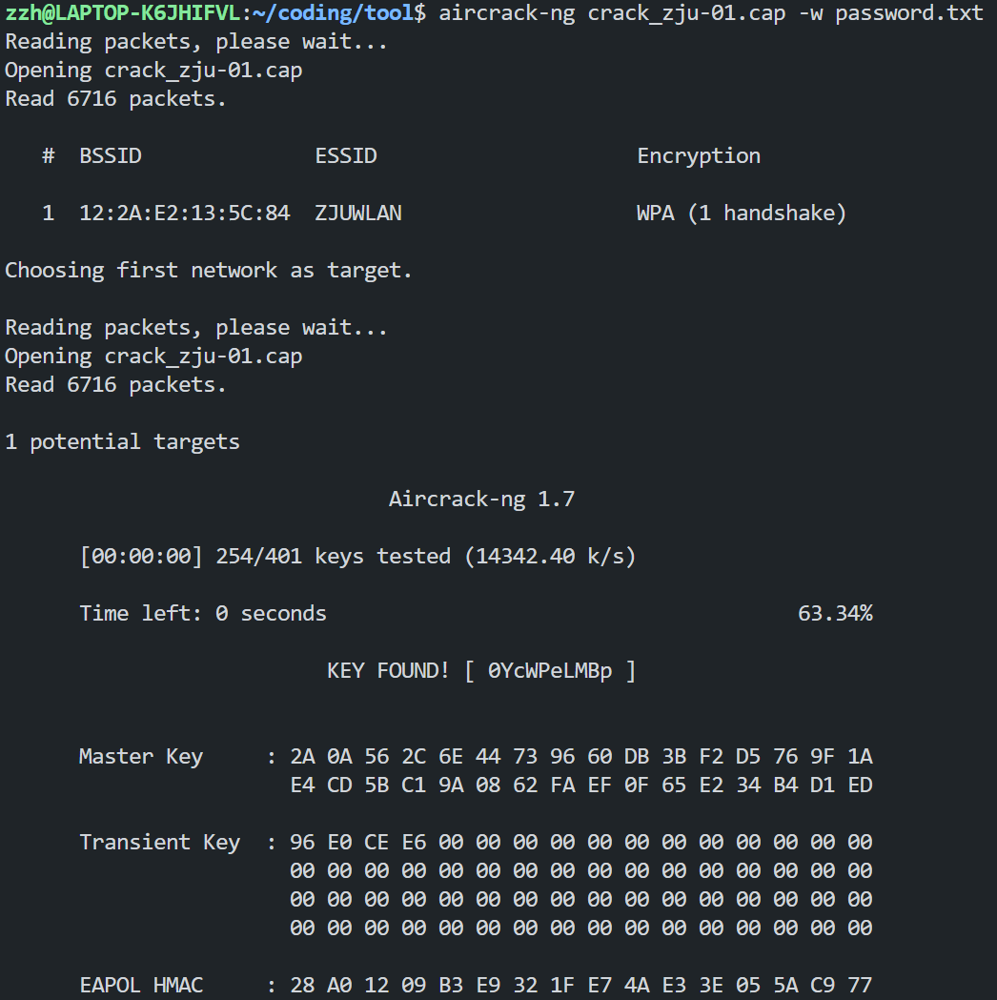

# Task 1

## Task 1.2

根据提示逐个尝试，得到有效结果如下：

```python
In :"鍘熺悊绫讳技璐濇柉浜斿崄鍏﷿殑璐濇柉浜屽崄鍏﷿紪鐮佸叾鍐呭﷿涓哄枬褰╁０甯曞笗鍒╅┈榄佸寳鍏嬪洖闊虫煡鐞嗗潎鍖€甯曞笗鍥為煶绁栭瞾浜虹嫄姝ユ帰鎴堝﷿鎷夊潎鍖€鏈变附鍙舵湵涓藉彾榄佸寳鍏嬪痉灏斿﷿绁栭瞾浜哄▉澹﷿繉楂樺皵澶﷿悆楂樺皵澶﷿悆鍩冨厠鏂﷿皠绾垮枬褰╁０濂ユ柉鍗″焹鍏嬫柉灏勭嚎绁栭瞾浜洪害鍏嬪洖闊冲潎鍖€绁栭瞾浜哄﷿鎷夊痉灏斿﷿閰掑簵鑳滃埄鑰呴珮灏斿か鐞冨叕鏂よ儨鍒╄€呴害鍏嬪崄涓€鏈堝洖闊宠儨鍒╄€呭▉澹﷿繉濉炴媺鍏﷿枻寰峰皵濉斿叕鏂ゅ嵃搴︽煡鐞嗛害鍏嬮樋灏旀硶鍗板害鍧囧寑濂ユ柉鍗″枬褰╁０".encode("gbk", errors="replace").decode("utf-8", errors="replace")
Out:'原理类似贝斯五十�?��贝斯二十�?��码其内�?为喝彩声帕帕利马魁北克回音查理均�?帕帕回音祖鲁人狐步探戈�?拉均�?朱丽叶朱丽叶魁北克德尔�?祖鲁人威�?��高尔�?��高尔�?��埃克�?��线喝彩声奥斯卡埃克斯射线祖鲁人麦克回音均�?祖鲁人�?拉德尔�?酒店胜利者高尔夫球公斤胜利�?�麦克十�?月回音胜利�?�威�?��塞拉�?��德尔塔公斤印度查理麦克阿尔法印度均匀奥斯卡喝彩声'
```

推测所得结果前半部分为 hint：`原理类似于 base58 的 base26 编码其内容为`，后半部分为对应北约音标字母的音译或意译，译得结果为：`bplqecupezftsujjqdzwggxboxzmeuzsdhvgkvmnevwskdkicmaiuob`。

参照 base58 原理，将`a-z`映射到`0-25`：

```python
def convert_to_number(string):
    string = string.strip().lower()
    alphabet = "abcdefghijklmnopqrstuvwxyz"
    num = 0
    if string == "":
        return ""
    for i in range(len(string)):
        cur_char = string[i]
        if cur_char in alphabet:
            num += alphabet.index(cur_char) * (26 ** (len(string) - i - 1))
        else:
            return -1
    return bin(num)
```

得到对应的二进制数：`101101001001010010101010100001101010100010001100111101101011001001100000111010101011111011100100100010101000000011011000100110001111001010111110100101101101110001100000101011101011111011001010110111001100011010011110100010001001001011011100110011101111101`。
考虑其长度应为 8 的倍数，且按 ascii 码转换为可打印字符，在前补 0，转换所得结果为：`ZJUCTF{Y0u_rE@lLy_Kn0W_encODIng}`。

# Challenge 1

## Task 1

### 编码方式

- GB2312:
  - 94\*94 分区区位码
    - 01-09 区为特殊符号。
    - 16-55 区为一级汉字，按拼音排序。
    - 56-87 区为二级汉字，按部首/笔画排序。
    - 10-15 区及 88-94 区未有编码。
  - 双字节编码：
    - 高位字节（区字节）: `0xA1-0xF7`
    - 低位字节（位字节）: `0xA1-0xFE`
- GBK:
  - 双字节编码：
    - 高位字节: `0x81-0xFE`
    - 低位字节: `0x40-0xFE`
- GB18030:
  - 多字节编码：
    - 单字节：`0x00-0x7F`
    - 双字节：`0x81-0xFE`+`0x40-0xFE`
    - 四字节：`0x81-0xFE`+`0x30-0x39`+`0x81-0xFE`+`0x30-0x39`

### 兼容实现

1. GBK 兼容 GB2312
   - GBK 的编码范围完全覆盖 GB2312 的`0xA1-0xF7`+`0xA1-0xFE`区域
   - GBK 在首字节`0x81-0xA0`和`0xF8-0xFE`部分新增字符，避免覆盖 GB2312 编码
2. GB18030 兼容 GBK
   - GB18030 的双字节编码范围完全覆盖 GBK 的`0x81-0xFE`+`0x40-0xFE`区域
   - GB18030 在四字节编码中新增字符，避免覆盖 GBK 编码

## Task 2

观察所给文本及 hint 的“特殊汉字”，结合搜索结果得知第一步关键为提取文本中特定康熙部首，区分其位于`U+2F00-U+2FDF`康熙部首区段或`U+4E00-U+9FFF`CJK 统一表意汉字区段。

执行以下代码:

```python
normal = "一二人入八几力十又口土士大子小山工手文方无日月木止比毛氏水玄玉生用目石示立竹老而自至色行言赤足身酉里金隶青非面革音骨鬲"
kangxi = "⼀⼆⼈⼊⼋⼏⼒⼗⼜⼝⼟⼠⼤⼦⼩⼭⼯⼿⽂⽅⽆⽇⽉⽊⽌⽐⽑⽒⽔⽞⽟⽣⽤⽬⽯⽰⽴⽵⽼⽽⾃⾄⾊⾏⾔⾚⾜⾝⾣⾥⾦⾪⾭⾮⾯⾰⾳⾻⿀"

text = open("字.txt", "r").read()

cnt = 0
for char in text:
    if char in kangxi:
        print(1, end="")
        cnt += 1
    if char in normal:
        print(0, end="")
        cnt += 1
print([cnt])
```

得到结果为：`00000110100001000001101000010000011010000100000111011011000001101101010000011011111100000111010010000001101001010000011001010000000110010001000001101010010000011011100100000110111111000001110010110000011010111000000110010000000001110101110000011011111100000110100111000001101000100000011101110100000000000000000000000000000000000000000000000000000000000000000000000000000000[374]`，计数结果 374 与题目中指出隐写信息容量 374bits 相符。
观察到字符串最前部重复出现 3 次`00000110100001`，推测其表示同一字符，同时观察到字符串中重复出现`00000011`后接一 7bit 数据，考虑`0000011`为标识符，后接的 7bit 数据为字符编码，字符串末尾一大串 0 为冗余数据。
字符串前三个数据`0100001`推测为对应 flag 格式`AAA{}`的`A`字符，最后一个有效数据`1011101`对应`}`，对比各自的 ascii 码，推测原数据+`0x100000`即得所求字符，结果所得 flag 为`AAA{U_rE41IY_kN0w_GB}`。
过程实现代码为`character.py`（见 attachments）。               

# Challenge 2

Wireshark 打开所给流量包，观察到其大量 TCP 流量负载中包含了`FAKE`和`fake`字样，认定对应流量为干扰项，利用过滤器`not tcp.payload contains "FAKE" and not tcp.payload contains "fake"`排除后进行后续步骤。

1. 直接搜索`devicename`，发现多条流量包含`"devicename":"OpenHarmony 3.2"`。
2. 直接搜索`appname`，仅发现一条流量包含`APPNAME`字段且值为空，观察到同条流量中含`"HOST":"com.example.calculator"`,认定该流量包对应应用程序为 calculator。
3. 直接搜索`version`，经筛选确认为`dmVersion`字段，发现仅一条流量包含`"dmVersion":"5.0.1"`。
4. 类似的，所得结果为`"softbusVersion":101`。

将`OpenHarmony_3.2_calculator_5.0.1_101`经 md5 加密得到`flag{9cbba4ca92014908452e64de19e3e7ad}`。

# Bonus Challenge

所给附件解压后得到`.password.txt.swp`文件恢复后得到破解所用密码表，利用 aircrack-ng 工具对`crack_zju-01.cap`进行破解，得到结果：

密码为`0YcWPeLMBp`，对应 flag 为`AAA{0YcWPeLMBp}`。
