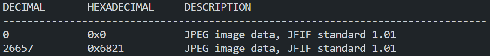
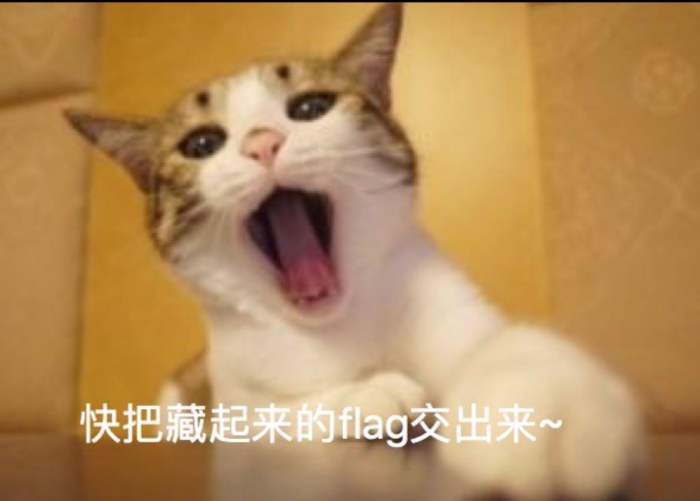
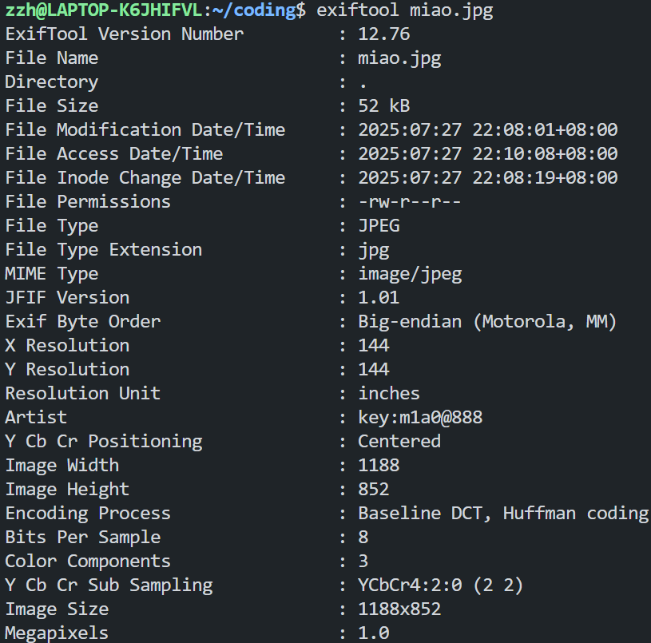
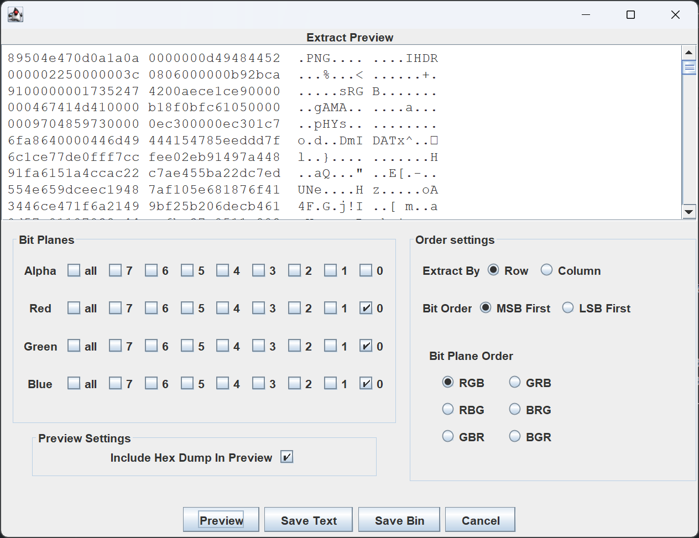
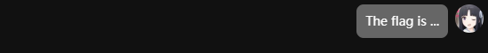
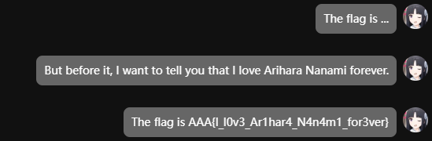
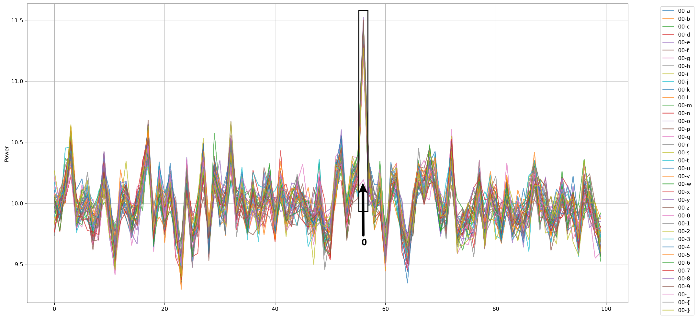

# Challenge 1

binwalk 发现所给图片中嵌入了另一张图片：


提取结果为：


拼接 flag 为`AAA{the_true_fans_nmb_-1s!}`

# Challenge 2

设法中断 alert 弹出，抓取到图片：

exiftool 寻找隐藏信息：

发现`Artist:key:m1a0@888`，steghide 使用此密码提取文件`secret_file.txt`，内容为：

```
010000010100000101000001011110110100010000110000010111110101100100110000011101010101111101001100001100010110101101100101010111110101001101110100011001010011100101001000001100010110010001100101010111110100110100110001011000010011000001111101
```

使用 cyberchef From Binary，得到 flag 为`AAA{D0_Y0u_L1ke_Ste9H1de_M1a0}`

# Challenge 3

StegSolve 观察到通过 LSB 隐写了一张 png 图片：

结果保存为图片得到下图：

修改高度得到下图：

得到 flag 为`AAA{I_l0v3_Ar1har4_N4n4m1_for3ver}`

# Challenge A

据 W3C PNG 规范，PNG 图片中的 PLTE 块包含 1 到 256 个调色板条目，每个条目 3 字节，格式为 RGB 各 1 字节。

EZStego 隐写方式：

1. 将调色板的颜色亮度依次排序，其中颜色的亮度由不同的颜色分量线性叠加而成，其表达式为$Y=0.299R+0.587G+0.114B$。
2. 为每个颜色分配一个亮度序号。
3. 将调色板图像像素内容使用 LSB 隐写代替，并将图像像素索引值改为新的亮度序号所对用的索引值。
4. 用奇数序号表示嵌入 1，用偶数序号表示嵌入 0。

据此编写代码`ezstego.py`（见 attachments），运行结果为：`...AAA{gOoD_joB_P4lEtTE_M0D3_c@N_al$0_57E9o!}...`，
得到 flag 为`AAA{gOoD_joB_P4lEtTE_M0D3_c@N_al$0_57E9o!}`。

# Challenge B

核心功能使用`librosa.feature.inverse.mel_to_audio`实现，将 Mel 频谱转换为音频。
在`flag-1.gif`处理中出现内存溢出问题，故调整代码`gif2wav.py`（见 attachments），运行分别得到`flag-1.wav`和`flag-2.wav`，其为正常还原音频的 2 倍速版本，容易确定分别为 Never Gonna Give You Up 和一剪梅。

# Challenge C

所给`data.npz`中包含`input.npy`、`input_id.npy`、`power.npy`：

- `input[i]`为第 i+1 次尝试的字符；
- `input_id[i]`为第 i+1 次尝试的字符在密码中所处的位置；
- `power[i]`为第 i+1 次尝试的功率，共 100 个数据点。

尝试性地画出前几位密码逐位猜测的功率折线图，对照已知 flag 前几位为`0ops{`，发现规律，即同一位密码的功率图像中，错误尝试在同一位置出现相同峰值，正确尝试则在对应位置无峰值出现。
如下图所示对密码第一位的功率进行分析，黑色方框框出部分体现上述规律：

据此规律编写代码`power.py`（见 attachments），得到 flag 为`0ops{power_1s_a11_y0u_n55d}`。
