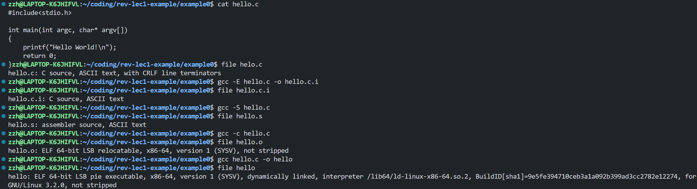
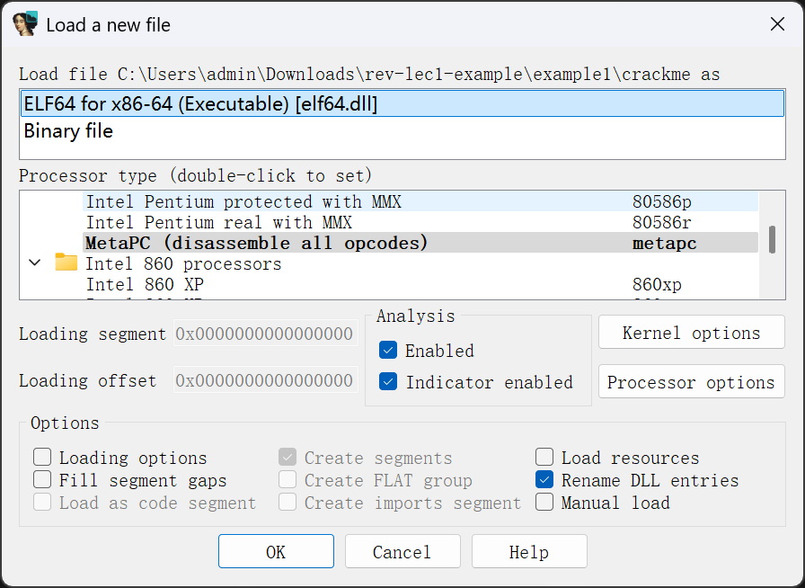
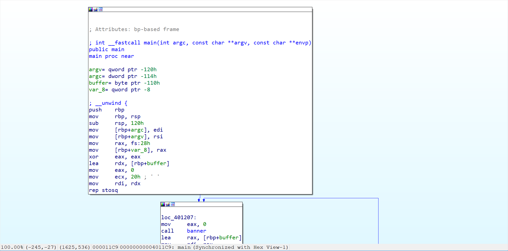
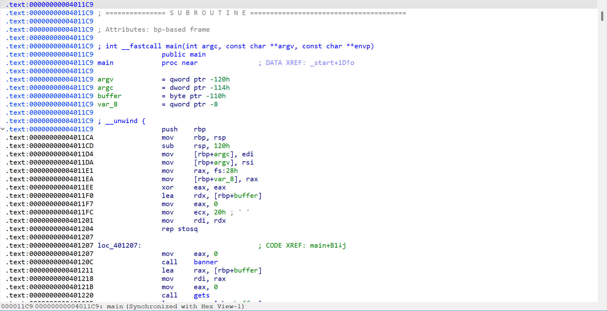
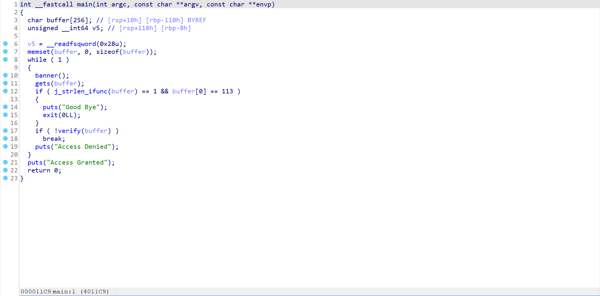

# Task 1

按照课上演示过程复现：

```bash
# 仅预处理； 不要编译、汇编或链接
gcc -E hello.c -o hello.c.i

# 只编译； 不要汇编或链接
gcc -S hello.c

# 编译和汇编，但不链接。
gcc -c hello.c

# 编译、汇编和链接
gcc hello.c -o hello
```

复现结果如下：


# Task 2

## IDA

### 常见功能

1. 文件加载与识别
   拖拽文件至 IDA，自动检测文件格式，自动识别处理器类型，定位入口点。
   
2. 反汇编
   自动将机器码转换为汇编代码，并图形视图或文本视图展现。
   
   
3. 反编译
   将汇编代码转换为 C 语言伪代码，便于理解程序逻辑。
   

### 快捷键使用

1. `F5`
   光标移至目标函数，通过`F5`生成伪代码，帮助理解程序逻辑。
2. `;`
   在汇编代码中添加注释，便于后续阅读和理解。

## GDB

### 常见命令

1. `run`(`r`)
   启动程序执行，可传递参数。
   ```bash
   (gdb) run arg1 arg2
   ```
2. `break`(`b`)
   设置断点。
   ```bash
   (gdb) break main
   ```
3. `continue`(`c`)
   继续执行程序，直到下一个断点或程序结束。
   ```bash
   (gdb) continue
   ```
4. `next`(`n`)
   执行下一行代码，不进入函数内部。
   ```bash
   (gdb) next
   ```
5. `step`(`s`)
   执行下一行代码，进入函数内部。
   ```bash
   (gdb) step
   ```
6. `print`(`p`)
   打印变量值或表达式结果。
   ```bash
   (gdb) print variable_name
   ```
7. `info`
   查看程序状态信息，如寄存器、堆栈等。
   ```bash
   (gdb) info registers
   (gdb) info stack
   ```
8. `quit`(`q`)
   退出 GDB 调试器。
   ```bash
   (gdb) quit
   ```

# Task 3

## Example 2

使用 IDA 对`main`函数分析反编译得到伪代码如下：

```c
int __cdecl __noreturn main(int argc, const char **argv, const char **envp)
{
  _BYTE v3[30]; // [esp+14h] [ebp-3Ch] BYREF
  _BYTE v4[26]; // [esp+32h] [ebp-1Eh] BYREF
  unsigned int i; // [esp+4Ch] [ebp-4h]

  qmemcpy(v4, "MMMwjau`S]]S}ybS?4:;5:<4<q", sizeof(v4));
  printf("Please input flag: ");
  scanf("%s", v3);
  for ( i = 0; i < 0x1A; ++i )
  {
    if ( (v3[i] ^ 0xC) != v4[i] )
    {
      printf("Your flag is not right.");
      exit(0);
    }
  }
  printf("You are right!");
  exit(0);
}
```

容易看出该程序对输入的字符串进行异或操作验证。将输入的字符串`v3`与预定义的字符串`v4`进行逐字符异或比较，如果不匹配则输出错误信息并退出，否则输出正确信息。
要求得目标 flag，可利用以下 python 脚本计算：

```python
v4 = "MMMwjau`S]]S}ybS?4:;5:<4<q"
key = 0xC
v3 = ""
for char in v4:
    decrypted_char = chr(ord(char) ^ key)
    v3 += decrypted_char
print(f"解密后的 v3: {v3}")
```

结果为：`AAA{fmyl_QQ_qun_386796080}`

## Example 3

使用 IDA 对`main`函数分析反编译得到伪代码如下：

```c
int __fastcall main(int argc, const char **argv, const char **envp)
{
  int v4; // [rsp+24h] [rbp-44h] BYREF
  void *Buf1; // [rsp+28h] [rbp-40h] BYREF
  char v6[56]; // [rsp+30h] [rbp-38h] BYREF

  sub_401770(argc, argv, envp);
  printf("please input the flag:");
  scanf("%s", v6);
  Buf1 = 0i64;
  sub_401570(v6, &Buf1, &v4);
  if ( !memcmp(Buf1, a5mc58bphliax7j, v4) )
    printf("\nsuccess!");
  else
    printf("\nfailed!");
  if ( Buf1 )
    free(Buf1);
  return 0;
}
```

容易看出该程序对输入的字符串`v6`进行处理并与预定义的字符串`a5mc58bphliax7j`进行比较。程序调用`sub_401570`函数对输入字符串进行处理，然后与预定义的字符串`a5mc58bphliax7j`进行比较，如果匹配则输出成功信息，否则输出失败信息。
`a5mc58bphliax7j`所指向的内容为`5Mc58bPHLiAx7J8ocJIlaVUxaJvMcoYMaoPMaOfg15c475tscHfM/8==`，基本认定为 base64 编码的字符串。
使用 IDA 对`sub_401570`函数分析反编译得到伪代码如下：

```c
__int64 __fastcall sub_401570(const char *a1, _QWORD *a2, int *a3)
{
  int v6; // r15d
  int v7; // r12d
  int v8; // r13d
  __int64 v9; // r14
  _BYTE *v10; // rax
  _BYTE *v11; // r9
  __int64 v12; // r8
  char v13; // cl
  char v14; // r11
  char v15; // r10
  __int64 result; // rax

  v6 = strlen(a1);
  v7 = v6 % 3;
  if ( v6 % 3 )
  {
    v8 = 4 * (v6 / 3) + 4;
    v9 = v8;
    v10 = malloc(v8 + 1i64);
    v10[v8] = 0;
    if ( v6 <= 0 )
      goto LABEL_5;
  }
  else
  {
    v8 = 4 * (v6 / 3);
    v9 = v8;
    v10 = malloc(v8 + 1i64);
    v10[v8] = 0;
    if ( v6 <= 0 )
      goto LABEL_8;
  }
  v11 = v10;
  v12 = 0i64;
  do
  {
    v11 += 4;
    v13 = a1[v12];
    *(v11 - 4) = aQvejafhmuyjbac[v13 >> 2];
    v14 = a1[v12 + 1];
    *(v11 - 3) = aQvejafhmuyjbac[(v14 >> 4) | (16 * v13) & 0x30];
    v15 = a1[v12 + 2];
    v12 += 3i64;
    *(v11 - 2) = aQvejafhmuyjbac[(v15 >> 6) | (4 * v14) & 0x3C];
    *(v11 - 1) = aQvejafhmuyjbac[v15 & 0x3F];
  }
  while ( v6 > (int)v12 );
LABEL_5:
  if ( v7 == 1 )
  {
    v10[v9 - 2] = 61;
    v10[v9 - 1] = 61;
  }
  else if ( v7 == 2 )
  {
    v10[v9 - 1] = 61;
  }
LABEL_8:
  *a2 = v10;
  result = 0i64;
  *a3 = v8;
  return result;
}
```

其中`aQvejafhmuyjbac`为 base64 编码表`qvEJAfHmUYjBac+u8Ph5n9Od17FrICL/X0gVtM4Qk6T2z3wNSsyoebilxWKGZpRD`。该函数将输入字符串`a1`进行 Base64 编码，并将结果存储在`Buf1`中，同时返回编码后的长度。
利用 Cyberchef `From Base64` recipe 自定义编码表，得到结果：`NSSCTF{a8d4347722800e72e34e1aba3fe914ae}`。
